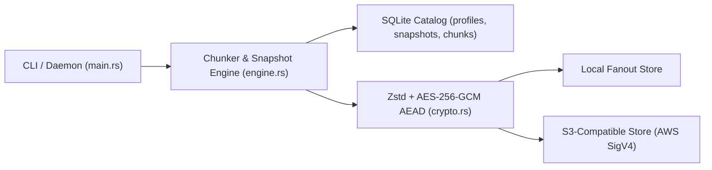

# SyncForge

Encrypted, chunked, deduplicated backup, snapshot, and synchronization CLI and daemon written in Rust with Local and S3-compatible storage backends.

## Overview & Problem Statement

Plain tarball backups duplicate unchanged files across snapshots, leak sensitive data when stored unencrypted, and fail to detect silent bit-rot or truncated archives until restore time. SyncForge chunks and deduplicates files by SHA-256, compresses with Zstd, encrypts every chunk via AES-256-GCM with authenticated chunk digests, maintains a transactional SQLite snapshot catalog, and verifies every byte on restore.

## Features

- **Chunking, Deduplication & Zstd Compression**: Splits multi-source inputs into configurable chunks, skips already-stored chunk hashes across snapshots/copies, and compresses with Zstd.
- **Authenticated Encryption**: PBKDF2-HMAC-SHA256 (`120,000` iterations) key derivation + AES-256-GCM AEAD per chunk with random 96-bit nonces and SHA-256 AAD binding.
- **Full, Incremental, Differential & Interrupted Resume**: Reuses unchanged `(size, mtime)` file entries and resumes `in_progress` snapshots (`--resume`).
- **Local & S3-Compatible Storage**: Stores encrypted chunks locally or on S3/MinIO using AWS Signature Version 4 (`HMAC-SHA256`).
- **Restore, Previews, Verify & Retention GC**: Full or `--only <file/prefix>` restore, `--dry-run` preview, path-traversal sanitization, cryptographic `verify`, `prune --keep-last N`, JSON `stats`, and scheduled `daemon` mode.

## Quick Start

1. **Requirements**: Rust / Cargo 1.78+
2. **Clone**: `git clone https://github.com/fully-ai/syncforge.git && cd syncforge`
3. **Build**: `./scripts/install.sh` (Windows: `.\scripts\install.ps1`)
4. **Initialize Vault**: `./target/release/syncforge --repo ./vault --passphrase "change-me" init`
5. **Run Backup**: `./target/release/syncforge --repo ./vault --passphrase "change-me" backup --source ./docs --mode full`
6. **Verify & Stats**: `./target/release/syncforge --repo ./vault --passphrase "change-me" verify && ./target/release/syncforge --repo ./vault --passphrase "change-me" stats`
7. **Restore**: `./target/release/syncforge --repo ./vault --passphrase "change-me" restore <SNAPSHOT_ID> ./restored`
8. **Run Tests**: `./scripts/test.sh` (Windows: `.\scripts\test.ps1`)

## Architecture

## Contributing & License

See [CONTRIBUTING.md](CONTRIBUTING.md), [SECURITY.md](SECURITY.md), and [LICENSE](LICENSE) (Apache 2.0).
